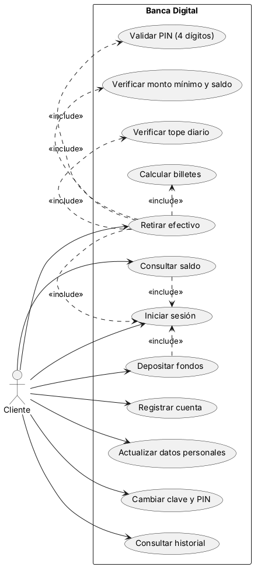
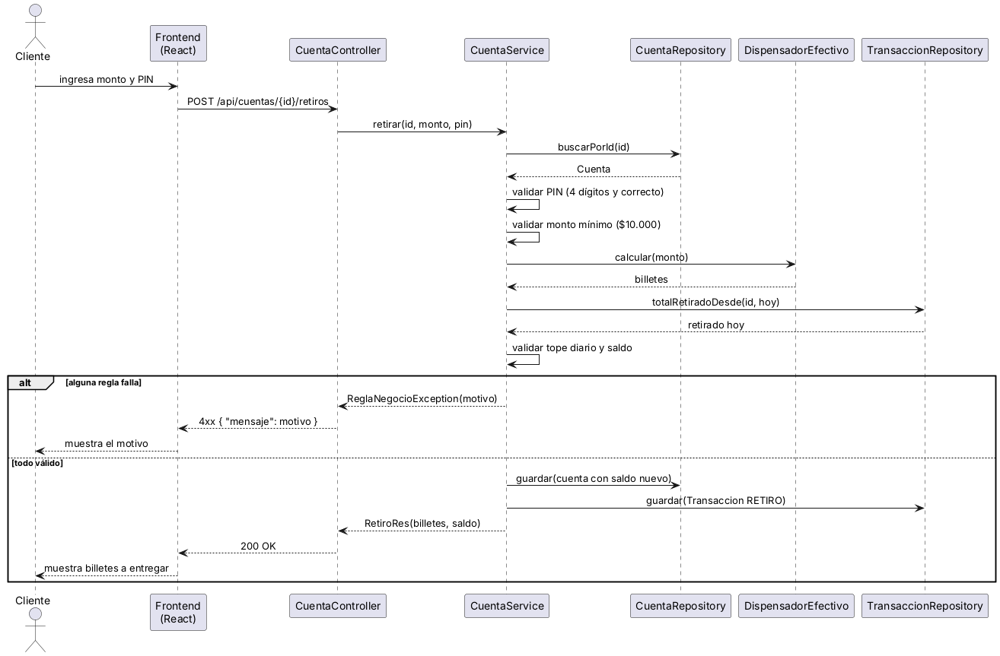
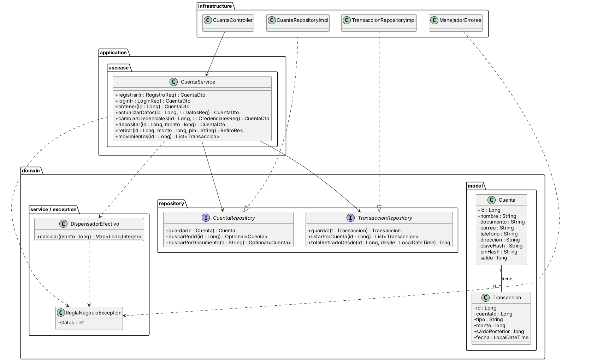
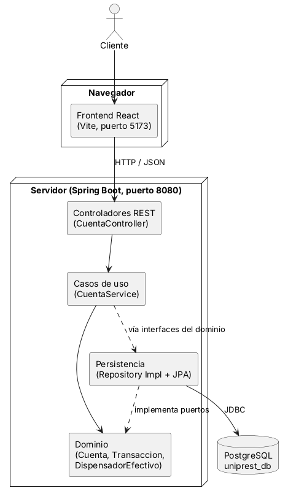

# Documentación – Banca Digital

Parcial Final – Análisis y Diseño de Sistemas (Facultad de Ingeniería de Sistemas e Informática).

| # | Documento | Contenido |
|---|---|---|
| 1 | [Ciclo de vida del software](01_ciclo_de_vida.md) | Modelo elegido, fases e iteraciones |
| 2 | [Requisitos](02_requerimientos.md) | Elicitación, requisitos funcionales y no funcionales, reglas de negocio, trazabilidad |
| 3 | [Historias de usuario](03_historias_usuario.md) | Historias con puntos y criterios de aceptación |
| 4 | [Arquitectura limpia](04_arquitectura_limpia.md) | Capas del backend y flujo del retiro |
| 5 | [Flujo de Git](05_flujo_git.md) | Ramas `main`, `develop`, `feature` |
| 6 | Diagramas UML (`uml/`) | Casos de uso, secuencia, clases y componentes (`.puml` y `.png`) |

Diagramas:

- 
- 
- 
- 
